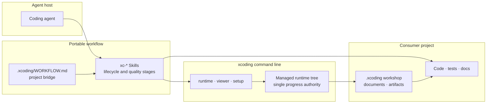
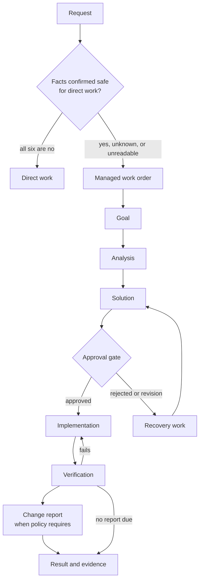
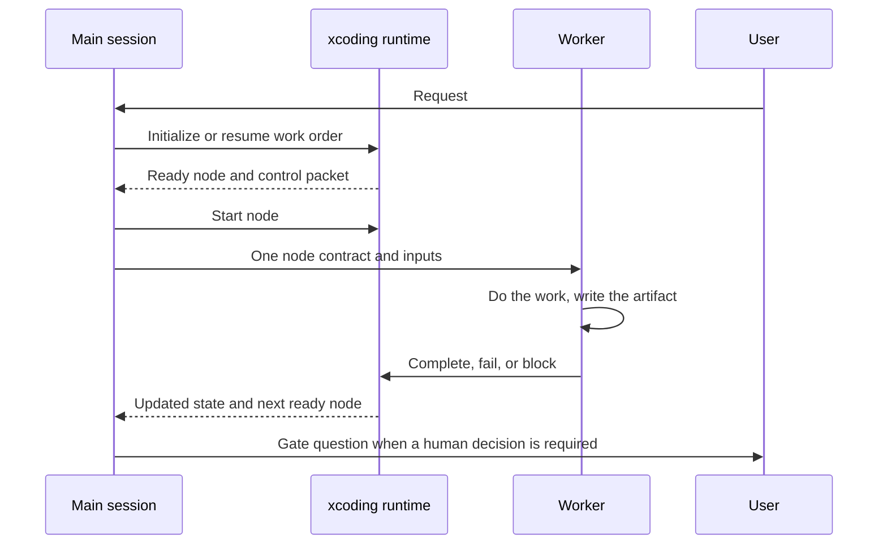

# xcoding-workflow

**Language:** **English** | [简体中文](README.zh-CN.md)

xcoding-workflow helps coding agents carry work from an initial request to a tested, reviewed result. It works across programming languages, frameworks, and the applications that run coding agents, known here as **Agent hosts**.

Current source candidate version: <!-- xc:version -->0.3.3<!-- /xc:version -->. The [version policy](docs/development/versioning.md) requires a recommendation and explicit user consent before a bump; a source version does not establish public release availability.

## How XC fits together

The workflow is portable text plus one small command line. The agent host supplies the model and tools; the `xc-*` Skills supply the lifecycle and its quality rules; the `xcoding` command owns deterministic state; the project's `.xcoding` workshop keeps the durable record; and the project's own bridge file supplies its commands, language, and constraints.



The bridge is the only read point for declarative project facts. The workshop is a separate Git repository, so workflow history never mixes with source history. Skills talk to state only through the `xcoding` command line; no Skill parses or edits the runtime tree directly.

## How a managed work order runs

Before changing anything, XC turns the request into a small set of confirmed facts. If the work is local, reversible, and needs no durable record, it can finish as one direct action. Any unanswered or risky fact sends it to a managed work order, where the lifecycle is preserved in a runtime tree rather than in a conversation.



The six facts are: whether progress or evidence must be kept for later; whether the work changes shared code, a public contract, user data, permissions, production or infrastructure state, a security boundary, or a release asset; whether a complete one-step rollback is unavailable; whether the work must wait, restart, continue in another session, or depend on an asynchronous result; whether multiple people, agents, or external systems coordinate; and whether a retained review, approval, verification, audit, or commit record is required. Each answer is `yes`, `no`, or `unknown`; only six confirmed `no` answers allow direct work. Project rules may require the managed path even then.

## Who does what at run time

The main session orchestrates; the runtime schedules; a worker executes one node. The worker receives only its own contract and inputs, so a long workflow does not depend on one context holding everything.



## See it work

The [sample work order](samples/minecraft-sandbox-work-order/README.md) is a real, complete run: a seeded consumer project was driven by the DeepSeek Harness command line through a create-mode managed lifecycle to build a playable 2D sandbox. The run uses the dynamic scope policy: `create` with a quality contract and no minimality presumption, so analysis, solution and the change report are deliberately omitted. The work order, its documents, its verification evidence and the rendered orchestration tree are all archived in the sample. It also contains one direct run of the same task without XC, with screenshots and an honest comparison.


The image is the final orchestration tree of that run, exported from the read-only local viewer. The sample README explains how to read it, including the skipped analysis, solution and change-report branches; the create-mode tree has no pending work.

## What it does

- XC uses a required `xcoding` CLI package plus workflow modules called **Skills**.
- Small, low-risk tasks can be completed directly.
- Work that needs a plan, review, recovery, or a durable record runs as a **managed work order**. The work order keeps the goal, decisions, progress, and evidence together.
- An explicitly adaptive managed work order can start with one combined work leaf and one finalizer, then add documents, analysis, gates, verification, review, and recovery as confirmed facts require.
- A work order that changed analysable code can produce a **change report**: one offline HTML file that explains each change, the design and trade-offs behind it, and where it sits in the larger flow, together with a mechanical proof that no analysable change unit was left unexplained.
- The `.xcoding` directory is the project's workflow workspace. It is kept in a separate Git repository, so workflow history does not mix with source-code history.
- [`xc-writing`](skills/xc-writing/SKILL.md) guides technical answers, explanations, drafting, revision, and writing review. It preserves evidence and conditions while adapting to the reader; it can be used independently or through the existing document-writing entry.
- Long-lived product features are managed only when you explicitly create or adopt them. Ordinary maintenance does not create a feature automatically.

## Choose direct or managed work

Before changing anything, XC asks the six questions listed above.

- Use **direct work** only when all six answers are confirmed `no`.
- Use a **managed work order** when any answer is `yes`, `unknown`, or cannot be checked.

Project rules may require managed work even when the general rules allow direct work. If new information appears during a direct task, answer the six questions again before continuing.

### Automation

The public classifier is:

```console
python skills/xc-work/scripts/classify.py [fact flags]
```

Its six flags are `needs_persistence`, `material_impact`, `difficult_rollback`, `crosses_sessions`, `multiple_actors`, and `audit_required`. Omitted flags become `unknown`. Invalid input, timeouts, execution failures, and invalid output all produce a managed result instead of silently allowing direct work.

Use [`xc-work`](skills/xc-work/SKILL.md) with `operation=run` to start managed work. This operation is always managed. Model name, vendor, context-window size, and project technology never change the six answers or remove required review and verification. Choose the mode from the task: `create` for a from-zero artifact with a user-facing quality contract, `change` for the minimum sufficient modification, and `repair` for a strong minimality presumption that promotes to `change` when the fix crosses a design or mechanism boundary.

`operation=adaptive-run` is an explicit managed alternative. It preserves a durable runtime while allowing a minimal workbench with no mandatory top-level documents. `operation=plan` derives monotonic capabilities from governance, project policy, scope, clarity, risk, verification, coordination, duration, audit, and `adaptive|fast|thorough` pace facts. Existing omitted or explicit `run` behavior remains the full lifecycle.

## Prerequisites

- Git. Configure a Git identity if you want XC to save automatic workflow checkpoints.
- CPython 3.12 or newer. The formal `0.1.0` verification baseline is Windows x86_64 with CPython 3.12.13; another accepted version is not a formal baseline unless its release evidence says otherwise.
- `uv` for isolated tool installation.
- Codex, OpenCode, Claude Code, or Trae on Windows x86_64. The exact validated host versions and experimental environments are listed in [Installation](docs/getting-started/installation.md).

## Install XC

The supported distribution is `xcoding-workflow`; `0.1.0` is distributed only as an immutable GitHub Release. It is not published on PyPI. If the immutable release and its integrity files are not available, there is no supported public installation artifact yet.

For a published release, download the wheel and integrity files from that same release and verify them as described in [Installation](docs/getting-started/installation.md). The following filename illustrates the current, unpublished `0.3.3` source candidate; it is not an available release artifact or evidence of release qualification. Install it only after a candidate wheel has been built and verified for your intended use:

```console
uv tool install /absolute/path/to/xcoding_workflow-0.3.3-py3-none-any.whl
xcoding version --json
```

Builds containing the new shortcut also support `xcoding --version`; existing installations can keep using `xcoding version --json` until upgraded to a build containing that change. Reinstalling the same historical wheel does not add the capability.

The installation creates only the `xcoding` command. Configure one or more explicit hosts from the consumer project root; repeated `--host` values form the complete desired host set:

```console
xcoding setup --project-root /absolute/path/to/consumer --host codex --host trae --json
```

Inspect the same plan without writing by adding `--dry-run`. If setup reports an interrupted journal, run explicit recovery; to restore the previous successful generation, run rollback:

```console
xcoding setup --project-root /absolute/path/to/consumer --recover --json
xcoding setup --project-root /absolute/path/to/consumer --rollback --json
```

Setup refuses unmanaged conflicts and drifted managed files instead of overwriting them. XC does not provide `install.ps1`, `install.sh`, a remote-script pipe command, automatic host detection, or a force option. See [Installation](docs/getting-started/installation.md) for host paths, desired-state updates, recovery, rollback, release integrity, and support policy.

## Create the workflow workspace

XC stores plans, progress, decisions, and evidence in `.xcoding`. Keep that directory in a separate Git repository so workflow history does not mix with source-code history.

Run one of the following examples from your project root only when `.xcoding` does not already exist. The commands create a sibling repository and connect its `.xcoding` directory to the project.

POSIX shell:

```sh
PROJECT_ROOT="$(pwd)"
WORKSHOP_ROOT="$(dirname "$PROJECT_ROOT")/$(basename "$PROJECT_ROOT")-xc-workshop"
mkdir -p "$WORKSHOP_ROOT/.xcoding"
git -C "$WORKSHOP_ROOT" init
ln -s "$WORKSHOP_ROOT/.xcoding" "$PROJECT_ROOT/.xcoding"
```

Windows PowerShell:

```powershell
$ProjectRoot = (Get-Location).Path
$WorkshopRoot = Join-Path (Split-Path $ProjectRoot -Parent) "$(Split-Path $ProjectRoot -Leaf)-xc-workshop"
New-Item -ItemType Directory -Force (Join-Path $WorkshopRoot ".xcoding") | Out-Null
git -C $WorkshopRoot init
New-Item -ItemType Junction -Path (Join-Path $ProjectRoot ".xcoding") -Target (Join-Path $WorkshopRoot ".xcoding") | Out-Null
```

If `.xcoding` already exists, find out what it points to and preserve that workspace instead of replacing it.

## Start Your First Managed Task

Run [`xc-workshop-setup`](skills/xc-workshop-setup/SKILL.md) once. Give it the project root and the `.xcoding` path. It records the project's real build, test, documentation, and commit rules.

Then choose one entry point:

- [`xc-work`](skills/xc-work/SKILL.md) for ordinary investigation, repair, review, or maintenance.
- [`xc-new-feature`](skills/xc-new-feature/SKILL.md) when you are starting a long-lived product feature and want XC to manage it explicitly.
- [`xc-feature-adoption`](skills/xc-feature-adoption/SKILL.md) when an existing feature should become managed before future changes.

Agent hosts use different invocation syntax. Follow your host's normal Skill syntax and pass the `project_root` and `workshop_path` parameters documented by the selected entry point.

## Documentation

- [Documentation index](docs/index.md)
- [Installation](docs/getting-started/installation.md)
- [Quick start](docs/getting-started/quick-start.md)
- [Core design](docs/concepts/core-design.md)
- [Orchestration overview](docs/orchestration/overview.md)
- [Writing and quality Skills](docs/reference/skills/implementation-and-quality.md)
- [Work-order sample](samples/minecraft-sandbox-work-order/README.md)

`build_agents.py` is only for developing this repository. It refreshes this checkout's local Skill mirror; it does not install XC into another project.

## License

Released under the [MIT License](LICENSE).
