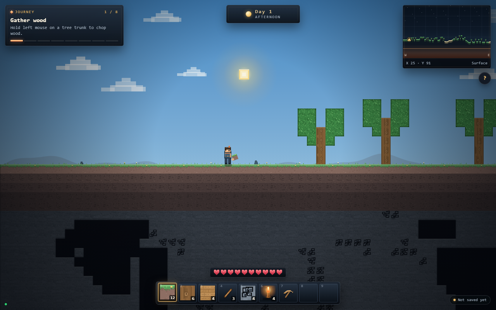
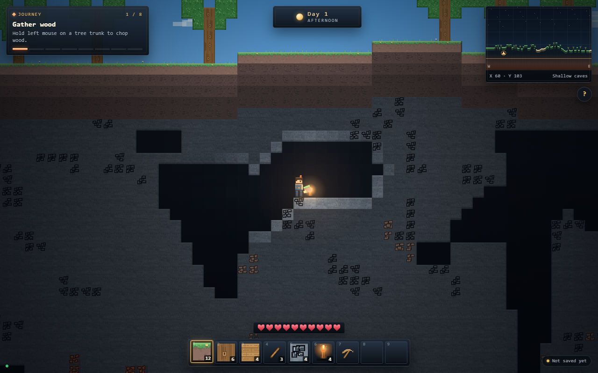

# Minecraft open 2D sandbox sample

This sample tests **one simple product prompt** under two conditions:

- **one-shot**: a single agent gets the prompt and the shared starter seed;
- **XC**: an agent gets the same product prompt and the starter seed, with the XC managed workflow
  available as process tooling.

The product prompt is identical: [`prompt.md`](prompt.md) and
[`baseline-prompt.md`](baseline-prompt.md). The XC runner has process instructions only
([`xc-runner.md`](xc-runner.md)); it must not add product requirements.

## Why this sample exists

The earlier compact sample explicitly made crafting/survival/mobs/redstone optional. That was useful
for a controlled regression, but it could not test whether an agent would discover Minecraft's
gather→craft→build loop. This sample does not pre-declare those systems as non-goals. The open prompt
and the new standard score what the agent actually chooses.

## Fairness rules

- Both runs start from the same `seed/` and the same product prompt.
- The one-shot run has no XC skills, workshop or process instructions.
- The XC run may use the workflow, but not extra product requirements or the old sample's profile.
- The evaluator sees anonymized A/B artifacts and does not know which is one-shot or XC.
- The new standard/profile is fixed before the runs; do not tune it to either result.

## Directory

| Path | Meaning |
| --- | --- |
| `prompt.md` | Product prompt used by both runs |
| `baseline-prompt.md` | The same prompt, for the one-shot condition |
| `xc-runner.md` | Process-only instructions for the XC condition |
| `seed/` | Shared starter project |
| `baseline/` | One-shot result (populated after the run) |
| `project/` | XC result (populated after the run) |
| `evaluation/` | New open-sandbox standard, profile, score sheet and blind review |
| `media/` | Screenshots |

## Result

Best XC artifact: **Emberdeep 0.4.15** (full-bleed + readable ores). One-shot **MOSSWILD**, blind v1.3.

| | One-shot A | XC 0.4.15 B |
| --- | ---: | ---: |
| PES | **82.4** | 82.3 |
| ECS | 80.3 | **88.6** |
| Composite | 81.9 | **83.9** |
| Experience tier | **polished** | solid |
| Art D5 | **86** | 67 |
| D6 map | 50 | **90** |
| High / medium | 0 / 2 | **0 / 0** |

B wins composite by 2.0 and is within 0.1 PES, but **D5 art is 67 vs 86**; this is the **0.4.15 cap
stop**, not a strict no-aspect-worse stop. The visual process (0.4.11 `xc-visual-design`) was also
validated cross-class on a non-game dashboard (0.4.13: 254/254 functional checks, two independent
critic cycles, no high/medium).

## Status

The runs and scores are recorded after both outputs exist. Do not compare this sample's score with the
compact `minecraft-sandbox-work-order` score; the prompts and profiles differ.

