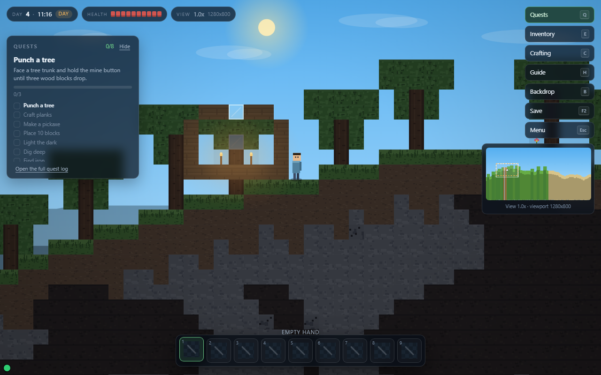

# Minecraft open 2D sandbox sample

This sample tests **one simple product prompt** under two conditions:

- **one-shot**: a single agent gets the prompt and the shared starter seed;
- **XC**: an agent gets the same product prompt and the starter seed, with the XC managed workflow
  available as process tooling.

The product prompt is identical: [`prompt.md`](prompt.md) and
[`baseline-prompt.md`](baseline-prompt.md). The XC runner has process instructions only
([`xc-runner.md`](xc-runner.md)); it must not add product requirements.

## Why this sample exists

The earlier compact sample explicitly made crafting/survival/mobs/redstone optional. That was useful
for a controlled regression, but it could not test whether an agent would discover Minecraft's
gather→craft→build loop. This sample does not pre-declare those systems as non-goals. The open prompt
and the new standard score what the agent actually chooses.

## Fairness rules

- Both runs start from the same `seed/` and the same product prompt.
- The one-shot run has no XC skills, workshop or process instructions.
- The XC run may use the workflow, but not extra product requirements or the old sample's profile.
- The evaluator sees anonymized A/B artifacts and does not know which is one-shot or XC.
- The new standard/profile is fixed before the runs; do not tune it to either result.

## Directory

| Path | Meaning |
| --- | --- |
| `prompt.md` | Product prompt used by both runs |
| `baseline-prompt.md` | The same prompt, for the one-shot condition |
| `xc-runner.md` | Process-only instructions for the XC condition |
| `seed/` | Shared starter project |
| `baseline/` | One-shot result (populated after the run) |
| `project/` | XC result (populated after the run) |
| `evaluation/` | New open-sandbox standard, profile, score sheet and blind review |
| `media/` | Screenshots |

## Result

The two runs are complete and blind-scored. Identity reveal: **A = one-shot (MOSSWILD)**, **B = XC
0.4.4 (Cubewood)**. Standard: **v1.3** (real-pointer interaction truth, blind pairwise art).

| | One-shot A | XC 0.4.4 B |
| --- | ---: | ---: |
| PES | 78.9 | 55.0 (raw 70.1; high cap) |
| ECS | 81.7 | 83.1 |
| Composite | 79.6 | 55.0 (raw 73.3; cap) |
| Experience tier | solid | prototype |
| High / medium / low | 0 / 1 / 1 | **1** / 2 / 2 |
| Higher | **A** | — |

**v1.2's 85.8 is invalid.** Its craft check used `element.click()`; a normal real click on Craft
no-ops because the craft list is rebuilt ~15×/s between mousedown and mouseup. The v1.3 evaluator
reproduced 0/10 normal clicks and applied the high-defect cap at 55. The art comparison is also
decisive: D5 83 vs 53, a 30-point gap.

The earlier v1.2 numbers (A 84.6 / B 85.8) are retained only as history. Do not use them as a stop
or promotion claim.

## Status

The runs and scores are recorded after both outputs exist. Do not compare this sample's score with the
compact `minecraft-sandbox-work-order` score; the prompts and profiles differ.

