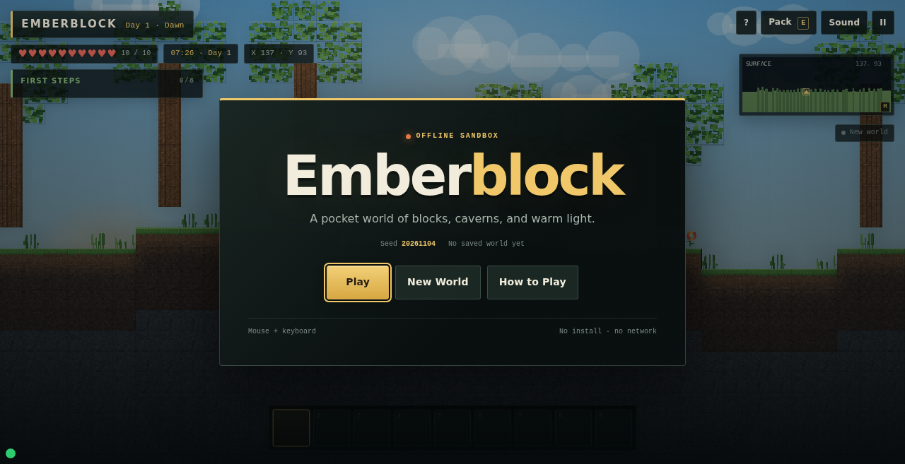
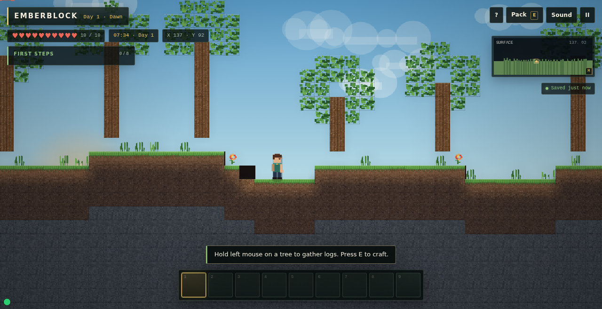
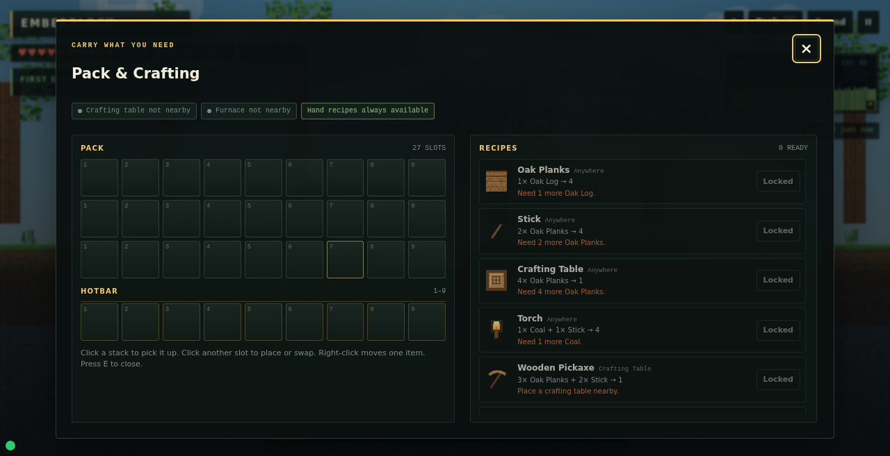
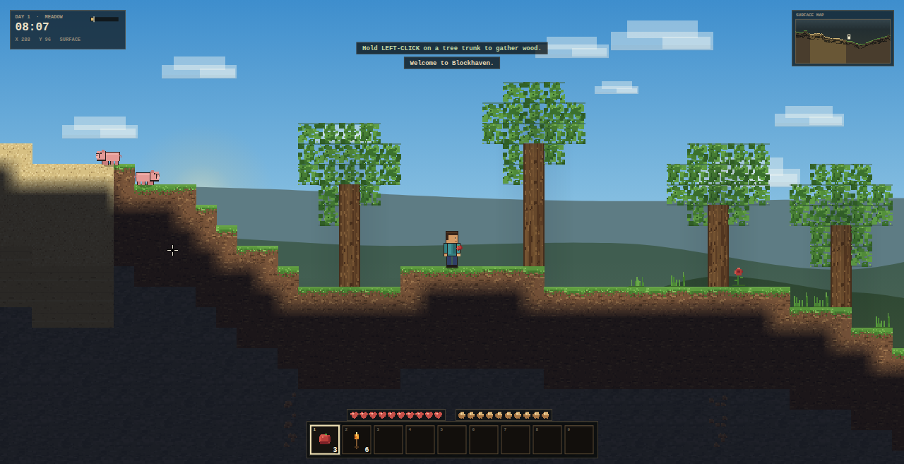

# Minecraft open 2D sandbox sample

This sample tests **one simple product prompt** under two conditions:

- **one-shot**: a single agent gets the prompt and the shared starter seed;
- **XC**: an agent gets the same product prompt and the starter seed, with the XC managed workflow
  available as process tooling.

The product prompt is identical: [`prompt.md`](prompt.md) and
[`baseline-prompt.md`](baseline-prompt.md). The XC runner has process instructions only
([`xc-runner.md`](xc-runner.md)); it must not add product requirements.

## Why this sample exists

The earlier compact sample explicitly made crafting/survival/mobs/redstone optional. That was useful
for a controlled regression, but it could not test whether an agent would discover Minecraft's
gather鈫抍raft鈫抌uild loop. This sample does not pre-declare those systems as non-goals. The open prompt
and the new standard score what the agent actually chooses.

## Fairness rules

- Both runs start from the same `seed/` and the same product prompt.
- The one-shot run has no XC skills, workshop or process instructions.
- The XC run may use the workflow, but not extra product requirements or the old sample's profile.
- The evaluator sees anonymized A/B artifacts and does not know which is one-shot or XC.
- The new standard/profile is fixed before the runs; do not tune it to either result.

## Directory

| Path | Meaning |
| --- | --- |
| `prompt.md` | Product prompt used by both runs |
| `baseline-prompt.md` | The same prompt, for the one-shot condition |
| `xc-runner.md` | Process-only instructions for the XC condition |
| `seed/` | Shared starter project |
| `project/` | XC result (populated after the run) |
| `evaluation/` | New open-sandbox standard, profile, score sheet and blind review |
| `baseline/` | Same-run one-shot artifact (0.4.17 Docker A) |
| `work-order/` | 0.4.17 Docker XC managed work order |
| `media/` | Screenshots |

## Result

Current public artifact: **Emberblock**, the XC condition of the 0.4.17 Docker A/B run (dsh
0.2.1-rc.5, deepseek-flash, one run each). It is a complete offline small-Minecraft sandbox:
generated world, mining/building, craft table/furnace progression, torches/day-night, health/death,
save/reload, first-run title, in-game tutorial quests, controls panel, pause, minimap and responsive UI.

| | One-shot A | XC 0.4.17 B |
| --- | ---: | ---: |
| PES | **88.3** | 83.7 |
| ECS | 50.8 | **91.5** |
| Composite | 78.9 | **85.7** |
| Experience tier | **polished** | **polished** |
| Art D5 | **89** | 81 |
| Tests | 0/1 (stale test fails) | **25/25** |
| page_check | fail (missing seed IDs) | **pass** |
| High / medium | 0 / 0 | 0 / 0 |

XC wins composite by **6.8** and ECS by 40.7; one-shot still leads PES by 4.6 and art by 8. Both are
polished with no high/medium defects. This is the first **significant composite/engineering win** for
XC, but not an all-aspect win: the one-shot remains stronger on experience and art.

**Historical results.** 0.4.7 Emberdeep remains the previous clean-seed reference at 81.1 vs one-shot
82.4 (PES 78.8, ECS 88.2, D5 51). 0.4.16 Blockfall was 77.6 vs 75.4. The 0.4.17 project is now the
public artifact; older projects are archived privately.

## Status

`work-order/` is the 0.4.17 Docker XC managed record for `project/`; `baseline/` is the same-run
one-shot artifact used in the blind comparison. Older 0.4.7 records are archived privately.

The runs and scores are recorded after both outputs exist. Do not compare this sample's score with the
compact `minecraft-sandbox-work-order` score; the prompts and profiles differ.

