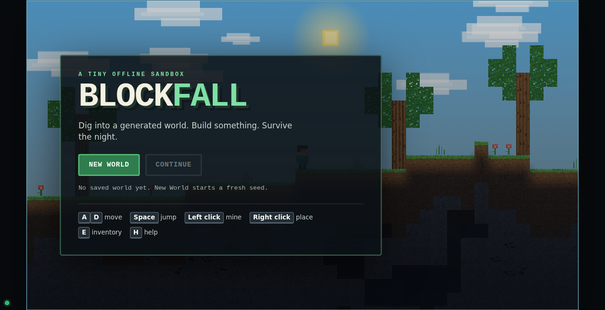
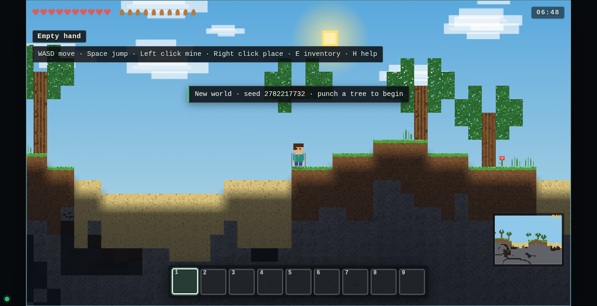
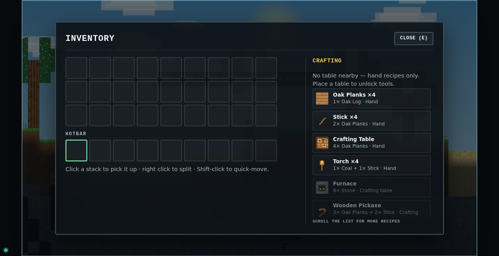

# Minecraft open 2D sandbox sample

This sample tests **one simple product prompt** under two conditions:

- **one-shot**: a single agent gets the prompt and the shared starter seed;
- **XC**: an agent gets the same product prompt and the starter seed, with the XC managed workflow
  available as process tooling.

The product prompt is identical: [`prompt.md`](prompt.md) and
[`baseline-prompt.md`](baseline-prompt.md). The XC runner has process instructions only
([`xc-runner.md`](xc-runner.md)); it must not add product requirements.

## Why this sample exists

The earlier compact sample explicitly made crafting/survival/mobs/redstone optional. That was useful
for a controlled regression, but it could not test whether an agent would discover Minecraft's
gather→craft→build loop. This sample does not pre-declare those systems as non-goals. The open prompt
and the new standard score what the agent actually chooses.

## Fairness rules

- Both runs start from the same `seed/` and the same product prompt.
- The one-shot run has no XC skills, workshop or process instructions.
- The XC run may use the workflow, but not extra product requirements or the old sample's profile.
- The evaluator sees anonymized A/B artifacts and does not know which is one-shot or XC.
- The new standard/profile is fixed before the runs; do not tune it to either result.

## Directory

| Path | Meaning |
| --- | --- |
| `prompt.md` | Product prompt used by both runs |
| `baseline-prompt.md` | The same prompt, for the one-shot condition |
| `xc-runner.md` | Process-only instructions for the XC condition |
| `seed/` | Shared starter project |
| `baseline/` | One-shot result (populated after the run) |
| `project/` | XC result (populated after the run) |
| `evaluation/` | New open-sandbox standard, profile, score sheet and blind review |
| `media/` | Screenshots |

## Result

Current public artifact: **Blockfall**, the XC condition of the first controlled Docker A/B run
(0.4.16, dsh 0.2.1-rc.5, deepseek-flash, one run each). It is a complete offline small-Minecraft
sandbox: generated island, mining/building, tool tiers, table/furnace, mobs/survival, 16 recipes,
save/reload, minimap, 58/58 tests, 16-state real-input play check.

| | One-shot A | XC 0.4.16 B |
| --- | ---: | ---: |
| PES | **85.2** | 74.2 |
| ECS | 46.2 | **87.9** |
| Composite | 75.4 | **77.6** |
| Experience tier | **polished** | solid |
| Art D5 | **86 polished** | 69 coherent |
| Tests | 0/1 (stale test fails) | **58/58** |
| page_check | fail (missing seed IDs) | **pass** |
| High / medium | 0 / 0 | 0 / 2 |

XC wins composite by 2.2, but loses PES by 11.0 and art by 17; this is **not a significant
experience win**. XC's two medium findings are an 800x600 minimap clip and vague insufficient-craft
feedback; its first-run UI also lacks a visible help/craft entry (D4 cap). The one-shot has the
stronger experience and art, but its seed tests/page check fail.

**This project is not the historical best XC score.** The 0.4.7 Emberdeep clean sample remains the
historical best at 81.1 vs one-shot 82.4; its project was archived before this replacement. The
current project is the Docker-verified 0.4.16 sample because it is the reproducible, isolated run.

### Historical result — 0.4.7 Emberdeep

A 0.4.7 clean sample scored **81.1 vs one-shot 82.4** (PES 78.8, ECS 88.2, D5 51 vs 89). It remains
the score best; its project was replaced here by the Docker-verified 0.4.16 artifact. The 0.4.9 cap
sample scored 79.2 vs 81.8.

## Status

`work-order/` is the historical 0.4.7 managed-workflow record; it does not describe the
Docker-verified 0.4.16 project now in `project/`.

The runs and scores are recorded after both outputs exist. Do not compare this sample's score with the
compact `minecraft-sandbox-work-order` score; the prompts and profiles differ.

