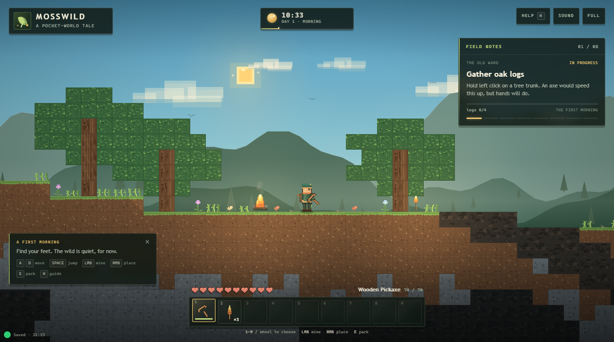

# MOSSWILD

A tiny, offline 2D block-world sandbox inspired by Minecraft. Wander a procedurally generated valley, mine and build, craft better tools, survive the hollows at night, and kindle the old Warden's Lantern.



Everything is local: plain HTML, CSS, and JavaScript, drawn with the Canvas 2D API. There is no build step, package install, server, CDN, or network access.

## Run it

Open `index.html` directly in a modern desktop browser (Chrome, Edge, or Firefox). That is the whole install.

The first page load creates a fresh seeded world. After that, the same browser resumes your saved world automatically. Sound starts after your first key press or click, as required by browser audio policies.

> Best played with a mouse and keyboard in a landscape window.

## Controls

| Input | Action |
| --- | --- |
| `A` / `D`, `←` / `→` | Walk |
| `Space` / `W` / `↑` | Jump |
| `Shift` | Sprint |
| Left mouse (hold) | Mine the block under the cursor / strike a hollow |
| Right mouse | Place the selected block, or set the selected torch / lantern / campfire down |
| `1`–`9`, mouse wheel | Choose a hotbar slot |
| `E` | Open / close the backpack and crafting bench |
| `H` | Open the in-game survival guide |
| `M` | Toggle sound |
| `F` | Toggle fullscreen |
| `Esc` | Pause; closes an open panel first |
| `Ctrl` + `S` | Save immediately |

In the backpack, click any block or owned tool to bind it to the currently selected hotbar slot. Only placeable blocks and tools can be bound; materials are used from the pack automatically. Placing a solid block on a targeted solid block puts it on top.

## The small loop

1. **Gather wood.** Hold left click on a tree trunk. The field notes in the top right track the first objectives.
2. **Craft a workbench.** Open the pack with `E`, turn a log into planks, then craft a workbench. Place it on the ground and stand nearby.
3. **Tool up.** Stone tools need a workbench in reach. Higher tiers replace the old tool and reset its durability. Pickaxes crack rock and ore, axes speed up wood, swords are best against trouble.
4. **Go below.** Coal glints in shallow caves. Iron requires a stone pickaxe. Torches make the dark manageable; caches of glowing amberstone are deeper still.
5. **Kindle the lantern.** Craft the Warden's Lantern with three iron, three coal, and one torch at a workbench, then place it anywhere in the wild. This completes the field notes and quiets the hollows.

### Survival notes

- **Hearts:** ten hearts, with slow natural regeneration after a long quiet spell.
- **Night:** hollows wake after dusk and attack at close range. They burn away at dawn. Placed light keeps them from spawning nearby.
- **Falling:** a short drop is safe; long falls hurt.
- **Death:** you wake back at camp with your pack intact.
- **Day length:** a full day/night cycle is five minutes, starting mid-morning. The clock at the top shows the current time and day.

## Saving

Progress autosaves to the browser's local storage every ten seconds, when you pause, when you complete the lantern, and when the page closes. The save includes the whole modified world, your position and health, inventory, tools and durability, hotbar, quest state, statistics, time of day, and sound setting.

The pause menu shows the seed and save status. **New world** in the pause menu requires a second click and replaces the current save. To reset from outside the game, clear this page's browser storage.

## Files

```text
index.html              page shell, HUD, panels, and local script order
favicon.svg             local pixel-leaf page icon
screenshot.png          a first-morning capture from the headless check
css/style.css           responsive HUD and pixel-paper UI
js/config.js            tuning constants and block IDs
js/content.js           blocks, items, tools, recipes, quest steps
js/time.js              day/night clock helpers
js/world.js             deterministic terrain, caves, ores, trees, serialization
js/player.js            AABB platforming physics, health, tools hooks
js/inventory.js         stacking, crafting, tool tiers, quest progress
js/art.js               procedural pixel textures, icons, player, hollows
js/audio.js             synthesized Web Audio sound effects and ambience
js/render.js            layered sky, parallax, world, lighting, day/night
js/ui.js                HUD, hotbar, backpack, help, pause, toasts
js/main.js              game loop, input, mining/building, enemies, saves
tests/                  Node tests for the pure simulation modules
tools/page_check.py     static file + headless render checks
tools/browser_check.mjs headless Chrome interaction/save/reload check
tools/quest_check.mjs   headless full quest, UI, death, and completion check
```

The game modules use small UMD wrappers so the same files run in the browser and under Node for tests. No module loader is required.

## Verification

```console
node --test "tests/**/*.test.js"
python tools/page_check.py --screenshot artifacts/page-check.png
node tools/browser_check.mjs
node tools/quest_check.mjs
```

The Node suite covers world generation, deterministic saves, crafting and tool gating, quest completion, collision physics, fall damage, and the clock. The Python check verifies the page has no external network references and loads the canvas and ready marker in headless Chrome. The two browser scripts drive the real page through Chrome DevTools: walking, mining, opening the pack, crafting, placing a workbench and lantern, completing the field notes, pausing, dying, respawning, and reloading a saved game. They write screenshots to `artifacts/`.

No game feature requires running the test tools, a server, or a package manager.
