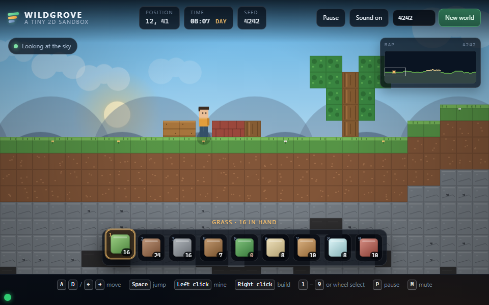

# Work-order sample: a 2D sandbox built through XC (0.3.8)

**Language:** **English** | [简体中文](README.zh-CN.md)

This is a real, complete XC **standard create-mode** work order, promoted from the 0.3.8 run. The
current public sample is **Wildgrove**, a playable offline 2D Minecraft-style sandbox built from the
seed by the standard managed lifecycle (goal, analysis, solution, approval, implementation,
verification, visual review and result). It is not a hand-written demo.



## Current result

| Field | Value |
| --- | --- |
| Sample version | **0.3.8** |
| Game | **Wildgrove — a tiny 2D sandbox** |
| Work order | `20261030-1819-mc-2d-sandbox` |
| Tests | **121/121** Node tests |
| Browser journeys | **70/70** executed checks |
| Page checks | 960x600 and 1280x800 pass; green `#status`; non-blank canvas |
| M2D-SES v1.1 | PES **69.2**, ECS **80.0**, composite **71.9** (independent strict **71.4**) |
| Defects | **0 high / 1 medium / 4 low** (independent review) |
| Stop reason | composite 71.9 (strict 71.4) ≥ historical best **71.3**; **PES 69.2 < E3's 71.2** |

The 0.3.8 sample fixes the world floor (unbreakable two-row bedrock), the underground backdrop
(removed blocks no longer reveal sky/parallax), mining feedback (0.22s break progress, cracks,
pickaxe swing), and orientation (live minimap). The independent stop-gate found one medium:
a valid-but-stale save with the player below the re-sealed floor loads embedded in the floor; the
strict score is 71.4, still above 71.3 by 0.1. Do not read this as a clean experience win: the
composite edge is narrow and PES remains below E3.

## What is in this directory

| Path | Contents |
| --- | --- |
| [`project/`](project/) | The complete Wildgrove sandbox; open `index.html` directly from `file://` |
| [`work-order/`](work-order/) | The 0.3.8 standard-lifecycle work order: goal, analysis, solution, result, node artifacts and runtime tree |
| [`seed/`](seed/) | The original skeleton the work order started from |
| [`baseline/`](baseline/) | The one-shot direct baseline used for comparison |
| [`evaluation/`](evaluation/) | The fixed M2D-SES v1.1 standard, 2D sandbox profile and score sheet |
| [`media/`](media/) | Screenshots; `xc-sandbox-0.3.8.png` is the current 960x600 capture |
| [`setup/`](setup/) | The consumer project's workflow bridge and runtime configuration |

## Evaluation snapshot

| Artifact | PES | ECS | Composite | High / medium |
| --- | ---: | ---: | ---: | ---: |
| **0.3.8 Wildgrove** | 69.2 | 80.0 | **71.9** (strict 71.4) | **0 / 1** |
| 0.3.7 LOAM | 60.0 capped (raw 68.6) | 84.5 | 65.0 | 1 / 3 |
| 0.3.6 Blockstead | 50.0 capped | 92.5 | 60.6 | 2 / 2 |
| 0.3.3 pre-correction | 70.4 | 74.0 | **71.3** | 0 / 4 |
| E3 / Verdant Hollow (reference) | **71.2** | 65.5 | 69.8 | 0 / 3 |

The historical best composite is 71.3; E3 has the best PES at 71.2. 0.3.8 is the first version in
this line to reach the composite stop line, with the caveats above. Full v1.0 and v1.1 history is in
the [score sheet](evaluation/SCORE-SHEET.md); 0.3.4/0.3.5 are not v1.1-scored because their complete
artifacts were not retained.

## Reproduce the checks

```console
cd project
node --test "tests/**/*.test.js"
python tools/page_check.py
node tools/journey_check.js
```

The page runs from `file://` with no framework, build step, package manager, external library, CDN,
font or network request. `project/README.md` documents the controls and architecture.

## Evaluation

Every sample run is scored with the fixed [M2D-SES v1.1](evaluation/STANDARD.md) and its
[2D sandbox profile](evaluation/PROFILE-2D-SANDBOX.md). The [score sheet](evaluation/SCORE-SHEET.md)
records PES, ECS, composite, defect caps, journeys and the historical reference set. The v1.0
standard and score sheet are retained as historical documents; v1.0 and v1.1 scores are not directly
comparable.

## Scope

The compact sample prompt intentionally excludes crafting trees, survival health/hunger, mobs/combat,
redstone, fluids and structures. Their absence is a profile non-goal, not a high defect. The sample
is judged on the requested sandbox experience, its world integrity, interaction feedback, presentation
and verification evidence.
