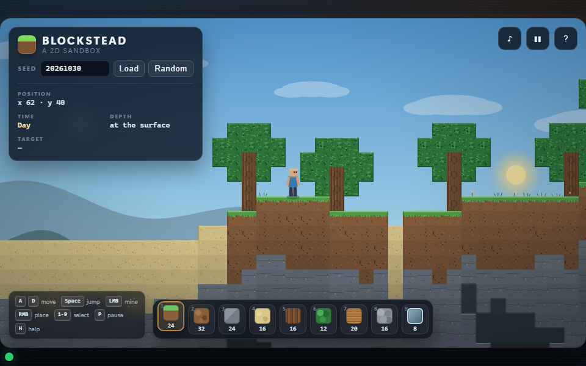

# Work-order sample: a 2D sandbox built through XC (0.3.6)

**Language:** **English** | [简体中文](README.zh-CN.md)

This is a real, complete XC **standard create-mode** work order, promoted from the 0.3.6 run. A seeded
consumer project was driven through the normal managed lifecycle by the DeepSeek Harness command
line; the resulting work order is archived here. A direct run of the same task without XC is included
for comparison.

The 0.3.6 run used the complete lifecycle — goal, analysis, solution, solution approval,
implementation, verification, result — with the create scope-fidelity, reference-signature and prior
capability-preservation contracts. The change report was deliberately waived. The run was isolated
from the one-shot baseline and every previous implementation: its workspace held only the workflow
Skills, the seed project and the bridge, and the prompt forbade consulting the baseline or a prior
implementation.

## Quick facts

| Item | Value |
| --- | --- |
| Task | Build a playable, offline 2D Minecraft-style sandbox from scratch |
| Version | **0.3.6** (current standard sample; v1.1 experience rank #4) |
| Consumer project | [`project/`](project/README.md), built from [`seed/`](seed/) |
| Host | DeepSeek Harness CLI, `dsh headless` |
| Model | `deepseek-flash` |
| Entry point | `xc-work` with `operation=run`, `mode=create` |
| Lifecycle shown | Goal, analysis, solution, approval, implementation, verification, result |
| Deliberately absent | Change report (explicit user waiver) |
| Quality bar | At least as polished and feature-rich as a strong one-shot; reference-informed signature experience; prior capabilities preserved |
| Isolation | Run workspace had no sample, baseline, prior result or existing implementation |
| Work order | `20261030-0000-minecraft-sandbox` |
| Archived tree | [`work-order/runtime/minecraft-sandbox.svg`](work-order/runtime/minecraft-sandbox.svg) |
| Baseline | One direct run of the raw prompt with no workflow, in [`baseline/`](baseline/) |

## What is in this directory

```text
prompt.md                 the standard create-mode prompt used for the 0.3.6 run
baseline-prompt.md        the raw task prompt used for the direct baseline
setup/                    project bridge and runtime configuration for the consumer workshop
seed/                     the starting snapshot the work order began from
project/                  the finished consumer project: the delivered game (28 files)
baseline/                 the direct baseline: index.html, run record and final answer
work-order/               the archived 0.3.6 work order: goal, analysis, solution, result,
                          review/verification artifacts, runtime tree and tmp evidence
evaluation/               the fixed M2D-SES v1.1 standard, 2D profile and score sheet;
                          v1.0 is retained as historical
tree/                     the earlier 0.3.3 tree, retained for provenance; the 0.3.6 tree is in work-order/runtime/
media/                    matched 960x600 screenshots of the managed and baseline pages
```

The live work order ran in an independent workshop Git repository outside this repository, and
`project/.xcoding` was a junction to it. The archived `work-order/` is a copy of that directory,
including its runtime and `tmp/` scratch. The live workshop is not part of this repository.

## What the 0.3.6 work order produced

The delivered page is [`project/index.html`](project/index.html), supported by local CSS, twelve
JavaScript modules and twelve test files. It delivers:

- seeded terrain with hills, strata, sand valleys, caves and trees, and a safe spawn;
- a player with gravity, acceleration, AABB collision, coyote time, jump buffering and variable jump;
- hold-to-mine with crack stages/particles, and face-adjacent placement with reach, empty-cell,
  player-overlap and stock rules, plus rejection feedback;
- a nine-slot hotbar with per-block counts, number keys, mouse-wheel cycling and a clear selected
  state;
- a smooth, world-clamped camera; a day/night cycle with sun/moon/stars, parallax hills, clouds,
  fireflies and torch/player lighting;
- procedural WebAudio cues with a persisted mute; numeric seed entry, pause, coordinates/depth HUD,
  1280-wide scaling, reduced-motion support and a controls/help panel;
- versioned `localStorage` save/restore of world, player, counts, selection and settings, with a
  defensive fallback;
- 124 automated tests and a green page check.

Verification, reproduced from `project/`:

```text
node --test "tests/**/*.test.js"    124 tests, 124 pass
python tools/page_check.py --window 960x600
                                    static/network checks pass; status marker green;
                                    202 colour buckets in the rendered canvas
```

The screenshot used below is [`media/xc-sandbox-0.3.6.png`](media/xc-sandbox-0.3.6.png). It is a clean 960x600
capture of the seed `20261030` and the default day state. The page is responsive: at other window
sizes the 960x540 stage scales and letterboxes, so the HUD/play area will look larger or smaller than
this crop. The game also restores `localStorage`; a previously saved seed, time or edited world can
therefore make a normal browser open look different. To reproduce the capture, enter seed `20261030`
and choose **Load**, or clear the page's site data, then use a 960x600 viewport.

## The direct baseline and the 0.3.6 result

The baseline used the same model (`deepseek-flash`), the same machine and the raw task prompt for one
direct run with the workflow disabled. The launch configuration and final answer are in
[`baseline/run.md`](baseline/run.md) and [`baseline/dsh-run.txt`](baseline/dsh-run.txt).

| Direct baseline | XC 0.3.6 standard create-mode work order |
| --- | --- |
|  |  |

| Fact | Direct baseline | XC 0.3.6 work order |
| --- | --- | --- |
| Deliverable layout | 1 file | 28 files (page, CSS, 12 modules, 12 tests, tool, README) |
| Served page bytes | 98,883 | 170,377 |
| Total project bytes | 98,883 | 185,102 |
| Committed logic tests | 0 | **124, all passing** |
| Automated page check | none provided | green marker, 202 canvas colour buckets |
| External references in served files | 0 | 0 |
| Durable process record | none | complete standard work order + runtime tree |
| Independent visual review | none | passed; no required findings |

The 0.3.6 result is a substantially larger, tested product than the one-shot baseline. Under the
v1.0 engineering-weighted formula it was the best-scoring artifact; under the v1.1 experience-first
standard it is **fourth**, because it has no sealed world floor and shows sky behind removed
underground blocks. The one-shot baseline is not the worst experience: it has a sealed bedrock floor
and an underground backdrop, so it beats 0.3.6 on PES despite having no tests or audio.

| Artifact | PES | ECS | Composite | Gate | High / medium |
| --- | ---: | ---: | ---: | --- | ---: |
| 0.3.3 pre-correction | 70.4 | 74.0 | **71.3** | pass | 0 / 4 |
| E3 / Verdant Hollow (reference) | **71.2** | 65.5 | 69.8 | pass | 0 / 3 |
| 0.3.3 standard | 57.6 | 81.0 | 63.5 | pass | **1 / 2** |
| **0.3.6 standard** | 50.0 (capped) | **92.5** | **60.6** | pass | **2 / 2** |
| one-shot baseline | 55.8 | 38.0 | 51.4 | pass | 0 / 3 |

v1.1 reports PES (75% of the composite), ECS (25%) and a capped composite. 0.3.6 has the highest ECS
(92.5: 124 tests, 12 modules, strong persistence/accessibility), but its two high defects cap PES at
50: no bedrock/floor, and underground voids that show sky. 0.3.3 standard has one high defect
(no bedrock) and a capped 57.6. pre-correction is #1 on the composite; E3 is #1 on pure PES; the
two are within rubric resolution (tie on experience). The v1.0 base/core/coverage table is
historical and not comparable with v1.1.

0.3.4 and 0.3.5 are **not re-evaluated under v1.1**: their complete artifacts are no longer retained,
so only their v1.0 historical scores (55/61/47 and 55/62/47) remain. A v1.1 score is not fabricated
from screenshots.

E3 / Verdant Hollow is the 2026-10-28 ablation condition E3 (blind letter F), added as a standing
**reference condition** for future sample comparisons — not a standard sample or release bar. It has
the richest core-sandbox world in the packet (four biomes, ores, bedrock, 14 blocks, minimap,
day/night and audio), but no counted inventory, 17 tests and no pause/reduced motion. Future runs
compare against it for world/presentation and core-demo quality.

## Regression history

| Version / run | Run shape | Served bytes | Total bytes | Tests | Buckets | Note |
| --- | --- | ---: | ---: | ---: | ---: | --- |
| 0.3.2 sample (C1) | full, no quality contract | 38.1 KB | 69,140 | 28 | 53 | historical; below baseline |
| 0.3.3 pre-correction | create-minimal (stages skipped) | 132,680 | 168,758 | 34 | 285 | superseded special; not a standard comparison |
| 0.3.3 standard | full lifecycle + quality contract | 111,090 | 141,977 | 33 | 292 | historical |
| 0.3.6 standard | full lifecycle + scope/signature/preservation contracts | 170,377 | 185,102 | **124** | 202 | current standard sample; v1.1 experience #4 |

A run-to-run difference from the superseded special is expected: the special skipped analysis/
solution, while the standard run keeps the normal lifecycle. 0.3.6 restores the counts/tests/
accessibility/responsiveness that 0.3.5 lost and improves the base/core indices. The full
per-version rationale is retained in the project's evaluation history.

## Reading the work order

The 0.3.6 runtime tree is [`work-order/runtime/minecraft-sandbox.svg`](work-order/runtime/minecraft-sandbox.svg)
(zoomable) with the managed XML at [`work-order/runtime/orchestration.xml`](work-order/runtime/orchestration.xml).
It reports `status=complete` with valid SHA-256 integrity, 45 succeeded nodes and 16 skipped
conditional nodes.

The work order documents are [`goal.md`](work-order/goal.md), [`analysis.md`](work-order/analysis.md),
[`solution.md`](work-order/solution.md) and [`result.md`](work-order/result.md). Review and
verification evidence are under [`work-order/artifacts/`](work-order/artifacts/). The earlier
[`tree/`](tree/) directory is the 0.3.3 tree, retained only for provenance.

## Evaluation standard

Every sample run is scored with the fixed [M2D-SES v1.1](evaluation/STANDARD.md): experience-first
**PES** (75% of the composite), a flexible **Engineering & Code Quality Score (ECS)** (25%), a small
minimum gate (boot/offline, no fatal errors, save recovery), and a ranked defect ledger. The
[2D sandbox profile](evaluation/PROFILE-2D-SANDBOX.md) defines the expected journeys and integrity
requirements; the [score sheet](evaluation/SCORE-SHEET.md) records the PES/ECS/composite and the
defect caps.

The v1.0 86-criterion table and scores are retained in [`STANDARD-v1.0.md`](evaluation/STANDARD-v1.0.md)
and [`SCORE-SHEET-v1.0.md`](evaluation/SCORE-SHEET-v1.0.md) for provenance; v1.0 and v1.1 scores are
not directly comparable. The standard is revised only through a deliberate versioned change;
completed score sheets are not overwritten.

## Reproduce it

Prerequisites: Python 3.12, Node.js 24, Google Chrome, Git, and the `xcoding` package plus the XC
skills installed for your host. From the repository root:

```powershell
$Checkout = (Get-Location).Path
$Sample = Join-Path $Checkout "samples/minecraft-sandbox-work-order"
$Workshop = Join-Path (Split-Path $Checkout -Parent) "minecraft-sandbox-workshop"

# Replace the finished project with a clean copy of the seed.
if (Test-Path "$Sample/project/.xcoding") { [System.IO.Directory]::Delete("$Sample/project/.xcoding", $false) }
Remove-Item "$Sample/project" -Recurse -Force
New-Item -ItemType Directory -Force "$Sample/project" | Out-Null
Copy-Item "$Sample/seed/*" "$Sample/project/" -Recurse -Force

New-Item -ItemType Directory -Force (Join-Path $Workshop ".xcoding") | Out-Null
git -C $Workshop init
Copy-Item "$Sample/setup/WORKFLOW.md" (Join-Path $Workshop ".xcoding/WORKFLOW.md")
Copy-Item "$Sample/setup/xc-orchestration-runtime.json" (Join-Path $Workshop ".xcoding/xc-orchestration-runtime.json")
New-Item -ItemType Junction -Path (Join-Path $Sample "project/.xcoding") -Target (Join-Path $Workshop ".xcoding")

$env:DEEPSEEK_API_KEY = "<the key from the harness credential store>"
$env:DSH_PERMISSION_MODE = "danger-full-access"
Get-Content $Sample/prompt.md -Raw | dsh headless -
```

For a regression run, copy the seed, Skills and `.agents` mirror into a separate workspace that
contains no public sample, baseline or prior result, and run there. The prompt's isolation rule
forbids consulting those paths.

When the run reports completion, the work order is
`$Workshop/.xcoding/work-orders/<work-order-id>/`. To render its tree:

```powershell
$Tree = "$Workshop/.xcoding/work-orders/<work-order-id>/runtime/orchestration.xml"
$viewer = xcoding viewer --tree $Tree --no-browser | ConvertFrom-Json
$svg = Invoke-WebRequest "$($viewer.url)api/trees/$($viewer.trees[0].tree_id)/svg"
[IO.File]::WriteAllBytes("orchestration-tree.svg", [Text.Encoding]::UTF8.GetBytes($svg.Content))
```

The archived `work-order/` is a copy of the original workshop directory, normalized to LF; it
therefore contains absolute paths from the original run.

## Limitations

- This is a single sample run. It documents one execution, not a benchmark.
- `seed/` is a reconstruction of the starting snapshot, not a byte-for-byte recovery from the
  original run; the finished `project/` and archived work order are the original artifacts.
- The baseline prompt and the managed prompt differ by design; the managed run also had to satisfy
  tests, documentation, verification, the quality contract and the isolation rule.
- No human play session was performed; checks are automated plus screenshot inspection.
- The page-check tool is part of the sample's consumer project, not a generic XC capability.
- The workflow contracts live in [`docs/`](../../docs/index.md); this sample illustrates them and
  does not define or extend them.
