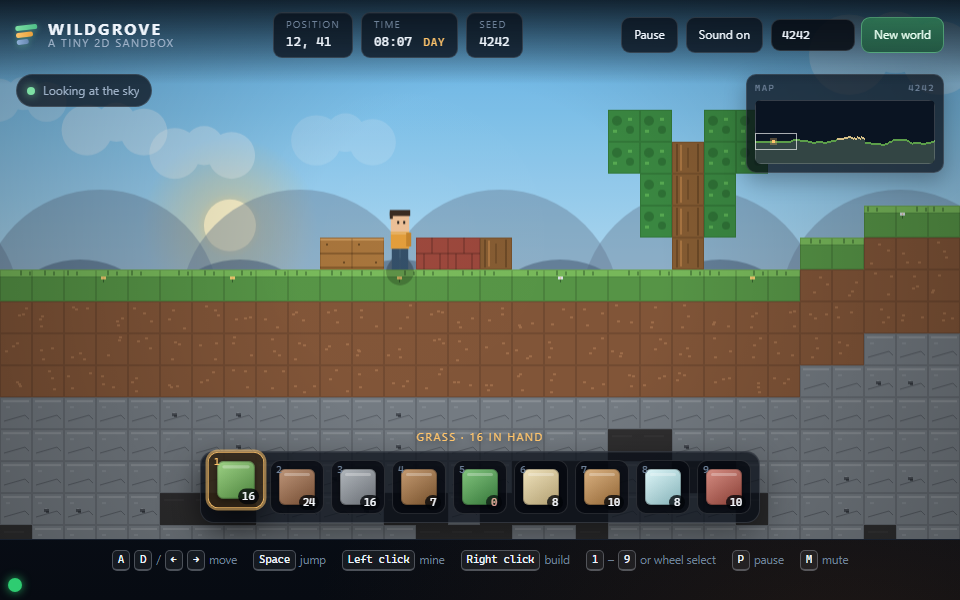

# 工单示例：通过 XC 构建的 2D 沙盒（0.3.8）

**语言：** [English](README.md) | **简体中文**

这是一个真实、完整的 XC **标准 create 模式**工单，已从 0.3.8 运行提升为公开示例。当前公开
sample 是 **Wildgrove**：由标准受管生命周期（goal、analysis、solution、approval、
implementation、verification、visual review、result）从 seed 构建的可玩离线 2D Minecraft 风格
沙盒，不是手写演示。



## 当前结果

| 项目 | 值 |
| --- | --- |
| Sample 版本 | **0.3.8** |
| 游戏 | **Wildgrove — a tiny 2D sandbox** |
| 工单 | `20261030-1819-mc-2d-sandbox` |
| 测试 | **121/121** Node tests |
| 浏览器 journey | **70/70** 实际执行检查 |
| Page check | 960x600 与 1280x800 通过；`#status` 绿色；canvas 非空 |
| M2D-SES v1.1 | PES **69.2**，ECS **80.0**，composite **71.9**（独立严格口径 **71.4**） |
| 缺陷 | **0 high / 1 medium / 4 low**（独立复核） |
| 停止原因 | composite 71.9（严格 71.4）≥ 历史最高 **71.3**；**PES 69.2 < E3 的 71.2** |

0.3.8 修复了世界底线（不可挖的两行 bedrock）、地下背景（移除方块不再露出天空/地表视差）、
挖掘反馈（0.22s break progress、裂纹、pickaxe swing）和方向感（live minimap）。独立停止门禁
发现一个 medium：一个合法但过期的 save 中玩家位于重新封闭的地板下方时，加载后会嵌入地板；
严格分数为 71.4，仍比 71.3 高 0.1。不要把它读成干净的体验胜利：composite 优势很窄，PES 仍低于 E3。

## 目录内容

| 路径 | 内容 |
| --- | --- |
| [`project/`](project/) | 完整的 Wildgrove 沙盒；直接双击 `index.html` 从 `file://` 运行 |
| [`work-order/`](work-order/) | 0.3.8 标准生命周期工单：goal、analysis、solution、result、节点 artifact 与运行时树 |
| [`seed/`](seed/) | 工单开始时的 skeleton |
| [`baseline/`](baseline/) | 用于对比的 one-shot 直接 baseline |
| [`evaluation/`](evaluation/) | 固定的 M2D-SES v1.1 标准、2D sandbox profile 与 score sheet |
| [`media/`](media/) | 截图；`xc-sandbox-0.3.8.png` 是当前 960x600 截图 |
| [`setup/`](setup/) | 消费项目的 workflow bridge 与运行时配置 |

## 评测快照

| 产物 | PES | ECS | Composite | High / medium |
| --- | ---: | ---: | ---: | ---: |
| **0.3.8 Wildgrove** | 69.2 | 80.0 | **71.9**（严格 71.4） | **0 / 1** |
| 0.3.7 LOAM | 60.0 capped（raw 68.6） | 84.5 | 65.0 | 1 / 3 |
| 0.3.6 Blockstead | 50.0 capped | 92.5 | 60.6 | 2 / 2 |
| 0.3.3 pre-correction | 70.4 | 74.0 | **71.3** | 0 / 4 |
| E3 / Verdant Hollow（参考） | **71.2** | 65.5 | 69.8 | 0 / 3 |

历史最高 composite 为 71.3；E3 的 PES 最高，为 71.2。0.3.8 是这条线中第一个达到 composite
停止线的版本，但必须带上上述 caveat。完整 v1.0/v1.1 历史见 [score sheet](evaluation/SCORE-SHEET.md)；
0.3.4/0.3.5 没有 v1.1 分数，因为完整 artifact 未保留。

## 复现检查

```console
cd project
node --test "tests/**/*.test.js"
python tools/page_check.py
node tools/journey_check.js
```

页面从 `file://` 运行，无框架、构建步骤、包管理器、外部库、CDN、字体或网络请求。
`project/README.md` 记录操作和架构。

## 评测

每次 sample 运行都用固定的 [M2D-SES v1.1](evaluation/STANDARD.md) 和
[2D sandbox profile](evaluation/PROFILE-2D-SANDBOX.md) 评分。
[score sheet](evaluation/SCORE-SHEET.md) 记录 PES、ECS、composite、defect caps、journeys 和历史
参考集。v1.0 标准与 score sheet 作为历史文档保留；v1.0 与 v1.1 分数不能直接比较。

## 范围

紧凑 sample prompt 有意排除 crafting trees、survival health/hunger、mobs/combat、redstone、fluids
和 structures。它们的缺失是 profile non-goal，不是 high defect。Sample 按请求的沙盒体验、世界
完整性、交互反馈、表现和验证证据评分。
