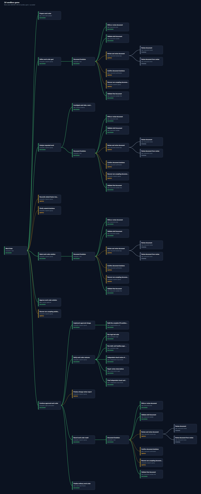
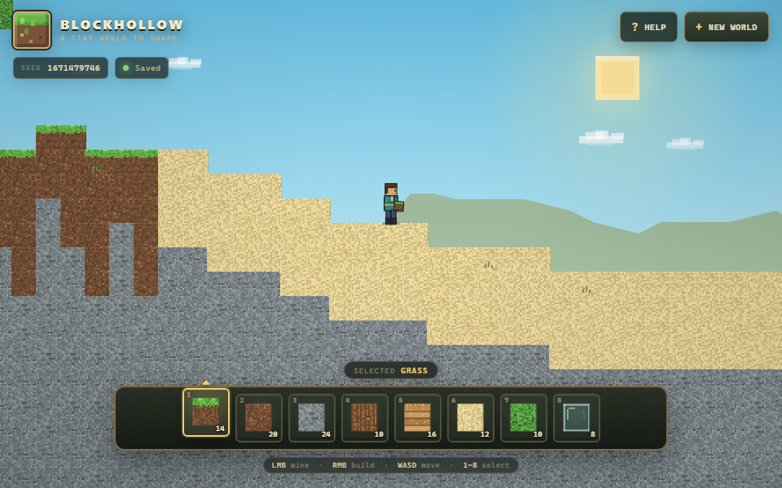
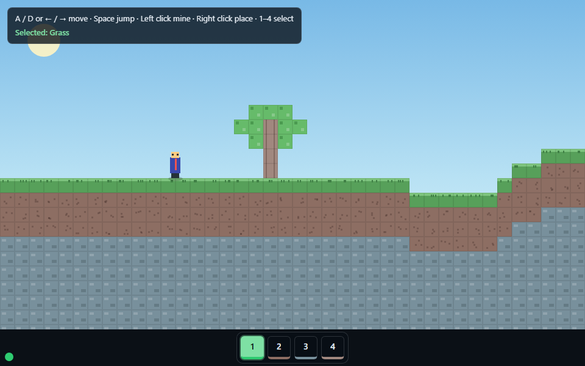

# 工单示例：用 XC 构建一个 2D 沙盒

**语言：** [English](README.md) | **简体中文**

这是一个真实、完整的 XC **标准 create 模式**工单示例，不是截图导览：一个预先准备种子内容的消费项目被 DeepSeek Harness 命令行按正常的受管生命周期完整推进，产物工单归档在这里，编排树由 runtime 渲染。示例还包含同一任务的第二次直接执行——不使用 XC——用来对照两种结果。

这次运行使用 `xc-work` 的 `mode=create`、用户可见质量契约和正常完整生命周期：goal、analysis、solution、solution approval、implementation、verification、result。变更报告被明确豁免。运行与 one-shot baseline 以及所有旧 sample 实现隔离：工作区只包含 workflow Skills、种子项目和桥接文档，prompt 禁止读取 baseline 或旧实现。

## 基本信息

| 项目 | 内容 |
| --- | --- |
| 任务 | 从零构建一个可离线游玩的 2D Minecraft 风格沙盒 |
| 为什么选它 | 常见的“模型能力”题目，结果可视、可检查，并且包含真实的设计决策 |
| 消费项目 | [`project/`](project/README.md)，由 [`seed/`](seed/) 种子构建出的最终静态页面 |
| 宿主 | DeepSeek Harness 命令行，`dsh headless` |
| 模型 | `deepseek-flash` |
| 入口 | `xc-work`，`operation=run`、`mode=create` |
| Scope policy | create：无最小化预设；goal 携带用户可见质量契约 |
| 展示的生命周期 | goal、analysis、solution、approval、implementation、verification、result |
| 刻意省略 | 变更报告（用户明确豁免） |
| 质量 bar | 至少与一次强 one-shot 尝试同样精致、同样丰富 |
| 隔离 | 运行工作区没有 sample、baseline、旧结果或已有实现 |
| 工单 | `20261029-1459-2d-sandbox-game` |
| 基线 | 用原始题目直接运行一次、不含任何工作流指令，产物在 [`baseline/`](baseline/) |

## 目录内容

```text
prompt.md                发给 DeepSeek Harness 的标准 create 模式 Prompt
baseline-prompt.md       直接基线使用的原始题目 Prompt
setup/WORKFLOW.md        消费项目的桥接文档模板
setup/xc-orchestration-runtime.json  示例工作区的 runtime 配置
seed/                    工单开始时的种子快照
project/                 完成后的消费项目：交付的游戏
baseline/                直接基线：index.html、运行记录与最终回答
work-order/              归档的标准工单：goal、analysis、solution、result、
                         评审/验证 artifact、runtime、tmp；没有 report
tree/                    最终编排树的 SVG（可缩放）与 PNG（README 用图）
media/                   受管结果与基线页面各一张 960x600 截图
```

实际运行时，工单位于仓库之外一个独立的示例工作区 Git 仓库中，`project/.xcoding` 是指向它的目录联接。`work-order/` 是那个工单目录的副本（含 `tmp/` 临时文件）再加上运行的最终回答 `work-order/dsh-run.txt`。那个活动工作区不属于本仓库。

## 为什么选这个任务

这个任务刻意为“新模型能力测试”那一类：从零写一个游戏。它结果可视，迫使实现做出真实决策（地形生成、碰撞、交互规则、相机、持久化），规模又足够在一个工单内完成。原始题目在 [`baseline-prompt.md`](baseline-prompt.md)；受管 Prompt 在同样的功能范围上增加了工作流指令、质量契约、验证要求和隔离规则。

## 工单是怎么跑的

1. 消费项目先准备好种子：页面壳、小型模块骨架、Node 测试入口和 Python 页面检查；种子快照归档在 [`seed/`](seed/)。沙盒功能全部未实现。
2. 在仓库之外创建隔离的运行工作区。它只包含 workflow Skills、`.agents` 镜像、种子项目和桥接文档；不包含公开 sample、baseline、旧项目或任何其他实现。
3. 从该隔离工作区启动：

   ```powershell
   $env:DEEPSEEK_API_KEY = "<harness 凭据存储中的 key>"
   $env:DSH_PERMISSION_MODE = "danger-full-access"
   dsh headless - < prompt.md
   ```

   无头配置要求 API key。权限模式在这台机器上也是必需的：默认的 `workspace-write` 沙箱无法完成 Windows ACL 设置，所有 shell 调用都会在启动前被拒绝。
4. 工单走正常的 create 生命周期：带质量契约的 goal、analysis、solution、solution approval、implementation、verification、独立视觉评审、result。变更报告被豁免；消费者项目不创建 commit。
5. Prompt 是为无头会话写的：禁止向用户提问，要求主会话记录决定，并且所有 runtime 访问只能走公开的 `xcoding runtime` 接口。

## 读编排树



PNG 是从 Viewer 的 SVG 导出的完整树。可缩放的独立版本是 [`tree/orchestration-tree.svg`](tree/orchestration-tree.svg)。树里能看到标准生命周期：准备、goal、analysis、solution 与方案闸门、implementation、带独立视觉评审与再次检查的 verification、result 与 finalizer。变更报告组和条件式 review/recovery 分支被跳过。树以 34 个成功节点、16 个跳过节点、8 个 pending 节点封存；pending 节点是被跳过条件分支的子节点，从未被调度。

归档的 runtime 树报告 `status=complete`，SHA-256 完整性校验通过。工单文档在 [`work-order/`](work-order/)：[`goal.md`](work-order/goal.md)、[`analysis.md`](work-order/analysis.md)、[`solution.md`](work-order/solution.md)、[`result.md`](work-order/result.md)。独立视觉评审在 [`work-order/artifacts/verification/independent-visual-review.md`](work-order/artifacts/verification/independent-visual-review.md)；验证证据在 [`work-order/artifacts/verification/`](work-order/artifacts/verification/)。

## 工单产出了什么

交付页面是 [`project/index.html`](project/index.html)，由本地 CSS、六个 JavaScript 模块和五个测试文件支撑。它提供：

- 种子地形：草、土、石、树、树叶、沙地空隙、洞穴和矿点；
- 玩家：重力、加速度、AABB 碰撞、coyote-time 跳跃、jump buffer、可变跳跃、落地事件、朝向和动画状态；
- 左键触及范围内挖掘（粒子/声音）、右键放置（触及、相邻、玩家身体规则，含明确的拒绝反馈）；
- 八格物品栏：数字键、滚轮循环、凸起选中格、色块、名称和数量；
- 平滑跟随并受世界边界限制的相机；全窗口 DPR-aware canvas；分层天空、太阳、云、鸟、视差山脊、雾、程序化地块纹理、洞穴背景、崖壁、环境光遮蔽、花、带头盔/围巾/背包/灯笼的角色、暗角；
- 品牌、种子信息、实时保存信息、声音/帮助按钮、提示栏、toast，以及含操作、材料、field notes、种子生成、随机化和两步重置的 field guide；
- 带版本的 `localStorage` 持久化：种子、方块、玩家、hotbar 和 inventory；有守卫访问和内存回退。

从 `project/` 复现的验证：

```text
node --test "tests/**/*.test.js"   33 个测试，33 通过
python tools/page_check.py --window 960x600
                                   静态/网络检查通过；状态标记为绿；
                                   渲染画布 292 个颜色桶
```

下方使用的截图是 [`media/xc-sandbox.png`](media/xc-sandbox.png)。

## 直接基线、当前结果与回归历史

启动会话使用同一模型（`deepseek-flash`）、同一台机器和原始题目，在没有工作流的情况下直接运行了一次。基线在 XC 检出之外运行，因此工作目录里没有本 checkout 的 `xc-*` Skills。启动配置与最终回答记录在 [`baseline/run.md`](baseline/run.md) 和 [`baseline/dsh-run.txt`](baseline/dsh-run.txt)；内部 transcript 未归档。

| 直接基线 | XC 标准 create 模式工单 |
| --- | --- |
|  |  |

| 事实 | 直接基线 | XC 标准 create 模式工单 |
| --- | --- | --- |
| 交付布局 | 1 个文件 | 15 个文件（页面、CSS、6 个模块、5 个测试、工具、README） |
| 服务页面字节 | 98,883 | 111,090 |
| 项目总字节 | 98,883 | 141,977 |
| 提交的逻辑测试 | 0 | 33，全部通过 |
| 自动页面检查 | 无 | 状态标记为绿，292 个颜色桶 |
| 服务文件中的外部引用 | 0 | 0 |
| 截图颜色桶 | 203 | 292 |
| 持久过程记录 | 无 | 完整标准工单 |
| 独立视觉评审 | 无 | 通过 |

标准结果在可测事实和截图对比上至少与 one-shot 基线持平：更强的世界呈现、带数量的八格物品栏、field guide、交互反馈，以及大得多的测试/验证记录。基线仍是干净的单文件页面和紧凑 HUD。

回归历史（保留在项目历史中）：

| 版本/运行 | 运行形态 | 服务字节 | 总字节 | 测试 | 色桶 | 说明 |
| --- | --- | --- | --- | --- | --- | --- |
| 0.3.2 sample (C1) | 完整，无质量契约 | 38.1 KB | 69,140 | 28 | 53 | 历史，低于 baseline |
| 0.3.3 pre-correction | 特例 create-minimal（跳阶段） | 132,680 | 168,758 | 34 | 285 | 被取代，不是标准对比 |
| 0.3.3 standard | 标准完整生命周期 + 质量契约 | 111,090 | 141,977 | 33 | 292 | 当前，至少 baseline |

与被取代的特例有运行间差异是预期内的：特例跳过了 analysis/solution，标准运行保留正常生命周期。当前结果的文件/字节少于特例，但颜色桶更多，且有完整的标准过程记录；这是被记录的比较，而不是回归。显著或连续下降才会触发调查。

对比的限制：每侧只跑一次、启动配置相同、Prompt 不同（受管 Prompt 还要求测试、文档、验证、质量契约和隔离规则）、静态截图对比、没有人类试玩。这是对这一次运行的记录，不是受控 benchmark。

## 复现

前置条件：Python 3.12、Node.js 24、Google Chrome、Git，以及为宿主安装的 `xcoding` 包和 XC Skills。从仓库根目录：

```powershell
$Checkout = (Get-Location).Path
$Sample = Join-Path $Checkout "samples/minecraft-sandbox-work-order"
$Workshop = Join-Path (Split-Path $Checkout -Parent) "minecraft-sandbox-workshop"

# 已提交的 project 是完成结果；先替换为干净的种子副本。
if (Test-Path "$Sample/project/.xcoding") { [System.IO.Directory]::Delete("$Sample/project/.xcoding", $false) }
Remove-Item "$Sample/project" -Recurse -Force
New-Item -ItemType Directory -Force "$Sample/project" | Out-Null
Copy-Item "$Sample/seed/*" "$Sample/project/" -Recurse -Force

New-Item -ItemType Directory -Force (Join-Path $Workshop ".xcoding") | Out-Null
git -C $Workshop init
Copy-Item "$Sample/setup/WORKFLOW.md" (Join-Path $Workshop ".xcoding/WORKFLOW.md")
Copy-Item "$Sample/setup/xc-orchestration-runtime.json" (Join-Path $Workshop ".xcoding/xc-orchestration-runtime.json")
New-Item -ItemType Junction -Path (Join-Path $Sample "project/.xcoding") -Target (Join-Path $Workshop ".xcoding")

$env:DEEPSEEK_API_KEY = "<harness 凭据存储中的 key>"
$env:DSH_PERMISSION_MODE = "danger-full-access"
Get-Content $Sample/prompt.md -Raw | dsh headless -
```

做回归测试时，把 seed、Skills 和 `.agents` 镜像复制到一个不含公开 sample、baseline 或旧结果的独立工作区，并在那里运行；prompt 的隔离规则禁止读取这些路径。上面的重置会删除完成文件与旧 `.xcoding` 联接；工作区步骤创建新的联接。

运行报告完成后，工单位于 `$Workshop/.xcoding/work-orders/<work-order-id>/`。渲染其树：

```powershell
$Tree = "$Workshop/.xcoding/work-orders/<work-order-id>/runtime/orchestration.xml"
$viewer = xcoding viewer --tree $Tree --no-browser | ConvertFrom-Json
$svg = Invoke-WebRequest "$($viewer.url)api/trees/$($viewer.trees[0].tree_id)/svg"
[IO.File]::WriteAllBytes("orchestration-tree.svg", [Text.Encoding]::UTF8.GetBytes($svg.Content))
```

归档的 `work-order/` 是原始工作区目录加上最终回答的副本，行尾统一为 LF；因此它包含原始运行的绝对路径。

## 评测标准

每次 sample 运行都用固定的 [M2D-SES v1.0](evaluation/STANDARD.md) 评分：12 个领域、86 条细则、
T0–T3 分层、权重、0–5 锚点，并分别报告 coverage/depth/extras。可复用的
[score sheet](evaluation/SCORE-SHEET.md) 记录各领域分数以及 base、core demo 和 coverage 指数。

当前 0.3.3 产物的 base 分数是 **standard 55/100**、**pre-correction 60/100**、**baseline
39/100**；core demo 为 61/65/44，coverage 为 47/50/31（standard/pre-correction/baseline）。
standard 更干净、更响应式、更稳；pre-correction 特例更接近
Minecraft 的系统空间，在世界/生物群系、方块/交互、昼夜和更丰富的 HUD 上更强。三者相对
Minecraft 都还很浅：没有合成、生存、生物/战斗、红石、水/沙子物理、天气或结构。领域表和
额外项/争议项见 [score sheet](evaluation/SCORE-SHEET.md)。

## 局限

- 这是单次示例运行，记录一次执行，不是 benchmark。
- `seed/` 是起始快照的重建，不是原始运行的逐字节恢复；完成的 `project/` 与归档工单是原始产物。
- 基线与受管 Prompt 按设计不同；受管运行还要满足测试、文档、验证、质量契约和隔离规则。
- 两侧都没有人类试玩；检查是自动化加截图审视。独立视觉评审是静态的，不是实时响应式或声学评审。
- 页面检查工具属于示例的消费项目，不是通用 XC 能力。
- 工作流契约在 [`docs/`](../../docs/index.md)；本示例只展示它们，不定义或扩展它们。
